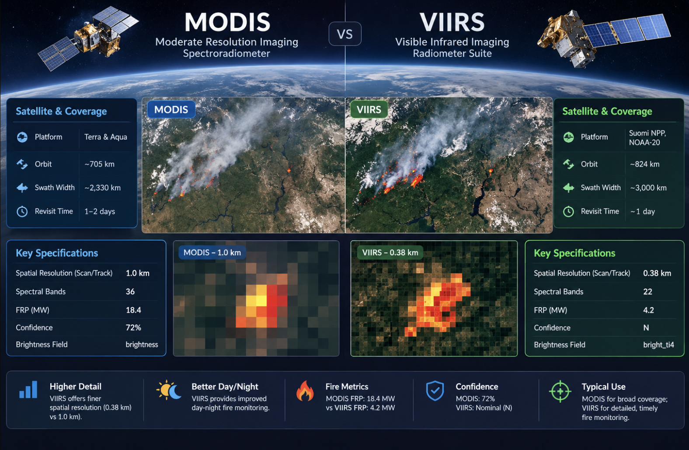

# TerraWatch — ML

Cross-sensor harmonization for **MODIS** and **VIIRS** active-fire detections, built on
[NASA FIRMS](https://firms.modaps.eosdis.nasa.gov/).

Full project spec: [`../../modis_viirs_hotspot_harmonization.md`](../../modis_viirs_hotspot_harmonization.md)



*The same fire through both instruments. VIIRS resolves it at 0.38 km and reports FRP
4.2 MW; MODIS averages that same burn into a 1.0 km pixel and reports 18.4 MW — neither
is wrong, they integrate different areas. Confidence shows the same mismatch: `72%`
versus a bare `N`. This is the problem the project has to solve.*

---

## The problem

MODIS and VIIRS both detect active fires, but their outputs are not interchangeable:

| | MODIS | VIIRS |
|---|---|---|
| Nominal pixel | 1 km | 375 m |
| Confidence | `0–100` (percent) | `l` / `n` / `h` (categories) |
| FRP | integral over ~1 km² | integral over ~0.14 km² |
| Swath width | 2330 km | 3060 km |
| Overpass (local) | Terra 10:30, Aqua 13:30 | 13:30 / 01:30 |

Combining them naively produces duplicated observations, inconsistent counts, and
confidence values that look comparable but are not.

**There is no ground-truth "this was a real fire" label available.** So instead of
training a fire detector, this component trains a model on an *observable* question:

> Given what VIIRS saw in a MODIS-sized footprint, would MODIS have detected fire there?

That single model provides three things the platform needs:

1. **A shared confidence scale** — one calibrated probability for both sensors.
2. **A matching score** — how likely two detections refer to the same fire.
3. **An explanation for single-sensor detections** — "MODIS probably wouldn't have
   caught this at 1 km resolution" vs "MODIS should have, and didn't."

## Status

| Stage | State |
|---|---|
| FIRMS ingestion + local cache | ✅ done |
| Label table (VIIRS-anchored) | ✅ done |
| Exploratory analysis | ✅ done |
| Baseline model (logistic regression) | ✅ done |
| Gradient boosting + monotonic constraints | ✅ done |
| Honest evaluation (spatial grouped CV) | ✅ done |
| Versioned model artifacts | ✅ done |
| Batch prediction + backend import | ✅ done |
| Temporal hold-out | ⬜ blocked on more data |
| Probability calibration | ⬜ not started |
| FRP harmonization | ⬜ not started |

## Quickstart

Requires **Python 3.14** (verified on 3.14.10).

```bash
cd ML
python3 -m pip install -r requirements.txt

cp .env.example .env        # then paste your FIRMS key
# free key: https://firms.modaps.eosdis.nasa.gov/api/map_key/
```

Everything runs through one entrypoint:

```bash
# fetch -> labels -> train in one go
python3 -m terrawatch all --start 2023-02-10 --end 2023-02-15
```

or one stage at a time:

```bash
python3 -m terrawatch fetch  --start 2023-02-10 --end 2023-02-15
python3 -m terrawatch labels --start 2023-02-10 --end 2023-02-15
python3 -m terrawatch train  --start 2023-02-10 --end 2023-02-15

# score a saved bundle
python3 -m terrawatch predict --bundle bundle.json

# or fetch a completed run from the Go backend, score it, and import it
python3 -m terrawatch predict-backend --api http://localhost:8000 --import
```

`--end` is **exclusive**, matching Python slicing. The example above covers 10–14 Feb.

Outputs land in `data/raw/` (Parquet cache), `data/labels/`, and `data/models/`.
Re-running is free — cached chunks are reused, never re-downloaded.

```bash
python3 -m pytest      # 25 tests, no network required
```

## Wiki

A single-page write-up of the process, decisions, data, and results lives at
[`wiki/index.html`](wiki/index.html) — self-contained, no build step.

Serve it from the `ML/` directory so the `../assets/` image resolves:

```bash
cd ML
python3 -m http.server 8765 --bind 127.0.0.1
```

Then open **<http://127.0.0.1:8765/wiki/>**.

Stop the server with `Ctrl-C`, or if it was backgrounded:

```bash
lsof -ti tcp:8765 | xargs kill
```

The page also opens directly by double-clicking `wiki/index.html`; only the
`../assets/` image needs the server.

## Layout

```
ML/
├── terrawatch/
│   ├── config.py      # Settings: bbox, thresholds, paths, .env
│   ├── ingest.py      # parallel, chunked, Parquet-cached FIRMS client
│   ├── geo.py         # great-circle distance, SpatialTimeIndex, grid blocks
│   ├── timeutils.py   # FIRMS HHMM -> comparable minutes
│   ├── labels.py      # label table + shared serving features (pure functions)
│   ├── features.py    # feature sets + monotonic constraints
│   ├── models.py      # model registry
│   ├── evaluate.py    # metrics, splits, grouped CV, leak checks
│   ├── artifacts.py   # versioned joblib artifacts + metadata
│   ├── predict.py     # bundle scoring + cluster aggregation
│   ├── backend_api.py # fetch a run from the Go API / import predictions
│   └── cli.py         # python -m terrawatch
├── tests/             # pytest suite
├── wiki/              # single-page write-up (serve from ML/)
├── assets/            # README + wiki images
├── data/              # git-ignored: raw/ cache, labels/, models/
├── .env               # git-ignored: FIRMS_KEY
└── requirements.txt
```

### Extending it

The point of the split is that scaling touches one file, not five:

| To add… | Edit |
|---|---|
| a model | `build_model` in `models.py` |
| a feature set | `FEATURE_SETS` in `features.py` — appears in `--feature-set` and the ablation table automatically |
| a data source | `Settings.sources` in `config.py` |
| a threshold or study area | `Settings` in `config.py`, or pass `--bbox` / `--max-scan` |
| a new pipeline stage | one command function in `cli.py` |

Scaling characteristics:

- **Download** is parallel (`ThreadPoolExecutor`) and chunked at the API's 5-day
  maximum, so multi-year backfills are bounded in memory.
- **Storage** is Parquet — roughly 5× smaller and faster to re-read than the raw CSVs.
- **Labelling** is a pure function over DataFrames, so it is unit-testable without
  network access and reusable from a notebook or the backend.
- **Evaluation** is parameterised by feature set, so comparisons are one CLI flag.

## The label table

One row per **VIIRS** detection (VIIRS detects ~5× more than MODIS, so anchoring on it
yields both classes automatically).

- **Label** `modis_detected` — 1 if any MODIS detection falls within **1.5 km** and
  **±30 min**, else 0.
- **Own-pixel features** — `frp`, `bright_ti4`, `bright_ti5`, `scan`, `track`,
  `conf_ord`, `is_night`, `doy`.
- **Footprint features** — `n_neigh`, `frp_sum`, `frp_max`, `ti4_mean`,
  `overpass_spread_min`: the aggregate of VIIRS pixels sharing the same 1.5 km
  footprint within ±5 min. This is the nesting encoded as numbers.

The footprint aggregate matters because MODIS's FRP is an integral over ~7 VIIRS
pixels. Summing VIIRS inside the MODIS footprint gives a median ratio of
**1.05** against MODIS FRP on matched pairs — the two sensors agree almost exactly
once you compare the same physical quantity.

## Serving and backend integration

Training now writes a versioned artifact to `data/models/`:

```text
lightgbm-2026-11-15.joblib   # fitted estimator
lightgbm-2026-11-15.json     # feature order, settings, training metadata, metrics
```

Serving uses the same `build_viirs_features` function as training. The caller
must pass **all VIIRS observations in the run's date range and bounding box**,
not only cluster members, because the footprint features (`n_neigh`, `frp_sum`,
`frp_max`, `ti4_mean`, `overpass_spread_min`) are computed from neighbours.

The bundle contract is:

```json
{
  "run_id": 1,
  "run_uid": "...",
  "clusters": [
    {"cluster_uid": "...", "members": [{"observation_id": 101, "role": "viirs"}]}
  ],
  "observations": [
    {
      "observation_id": 101,
      "sensor": "VIIRS",
      "satellite": "Suomi NPP",
      "acquired_at": "2024-01-01T10:32:00Z",
      "latitude": -1.29,
      "longitude": 36.82,
      "frp": 4.2,
      "brightness": 320.1,
      "brightness_aux": 290.4,
      "scan": 0.4,
      "track": 0.4,
      "confidence_class": "nominal",
      "daynight": "N"
    }
  ]
}
```

`predict` scores every VIIRS member and aggregates to one probability per
cluster. The default aggregation is `max`; `mean` is also available. Clusters
with no VIIRS member are skipped. `frp_calibrated` is not emitted because the
current model does not predict FRP.

Fetch a completed backend run, score it, and import the result:

```bash
python3 -m terrawatch predict-backend \
  --api http://localhost:8000 \
  --run-id 1 \
  --import
```

The backend must have a completed harmonization run and a model artifact must
exist in `data/models/`. The import is all-or-nothing and keyed by
`cluster_uid`, so run harmonization with the same rule used in training
(1.5 km / 30 min).

## Findings so far

Kenya, **2023-02-10 → 2023-02-14** (5 days): 355 MODIS detections, 1,933 VIIRS.

**Signal exists.** Base rate 11.2%. Single-feature predictive power:

| feature | ROC-AUC | PR-AUC |
|---|---|---|
| `frp_sum` (footprint) | 0.786 | 0.409 |
| `frp_max` (footprint) | 0.780 | 0.449 |
| `n_neigh` | 0.754 | 0.353 |
| `bright_ti4` | 0.699 | 0.221 |
| `frp` (own pixel only) | 0.692 | 0.240 |
| `conf_ord` | 0.510 | 0.131 |

The footprint aggregate beats the single pixel (0.786 vs 0.692), independently
confirming the nesting hypothesis.

**VIIRS confidence is nearly uninformative** (AUC 0.510 ≈ coin flip). Harmonized
confidence cannot be a rescaling of `l`/`n`/`h` — it has to be learned.

**Accuracy is a trap.** 88.8% of rows are negative, so predicting "no fire" always
scores 88.8% accuracy. Report **PR-AUC** (floor = 0.112), not accuracy.

**Terra is unusable for tight matching** at ±30 min:

| MODIS satellite | matched |
|---|---|
| Aqua | 47.0% |
| Terra | 0.0% |

Terra passes ~3 hours before VIIRS S-NPP, so no Terra detection has a VIIRS partner
within 30 minutes. Tight temporal matching only exists for **Aqua ↔ VIIRS**.

## Training results

1,933 rows, 217 positives (11.2%), grouped 5-fold CV over 57 spatial cells.

### The same model, evaluated two ways

| split | model | PR-AUC | ROC-AUC | Brier |
|---|---|---|---|---|
| random (optimistic) | logistic | 0.578 | 0.812 | 0.071 |
| random (optimistic) | lightgbm | **0.825** | 0.952 | 0.041 |
| grouped CV (honest) | logistic | 0.419 | 0.735 | 0.085 |
| grouped CV (honest) | lightgbm | 0.479 | 0.793 | 0.081 |
| grouped CV (baseline) | dummy | 0.110 | 0.500 | 0.101 |

Random splitting inflates LightGBM's PR-AUC by **+0.346** (~72% relative). The
0.825 figure is memorisation: neighbouring pixels of the same fire land on both
sides of the split.

### Feature ablation (grouped CV, LightGBM)

| feature set | PR-AUC |
|---|---|
| physics only | **0.486** |
| physics + night | 0.472 |
| physics + geometry + night | 0.479 |
| physics + geometry + night + `doy` | 0.561 |

The jump to 0.561 comes entirely from `doy` (day-of-year). With only 5 days it is
effectively a date ID, and the folds hold out **space but not time** — so it leaks.
The honest figure is **~0.48**.

### What the model actually leans on

LightGBM split counts: `scan` 558, `track` 505, `log_frp_max` 152, `n_neigh` 144,
…, `conf_ord` **0**.

- The top two features are **viewing geometry**, not fire physics — consistent with
  the swath-edge confounder above.
- The model **never splits on confidence at all**, corroborating the AUC-0.510
  result: VIIRS confidence carries no cross-sensor information.

### Takeaway

Physics features alone (`frp_max`, `n_neigh`, brightness) reach PR-AUC **~0.48** on
honest spatial hold-out, roughly 4× the 0.112 base rate. That is a real but modest
signal on a 5-day sample — enough to justify the approach, not enough to quote as a
final number. The next meaningful gain comes from more data and removing the
geometry confounder, not from a bigger model.

## Known limitations

- **Swath-edge coverage bias.** MODIS's swath (2330 km) is narrower than VIIRS's
  (3060 km), so VIIRS detections near its own swath edge are often outside MODIS
  coverage entirely. Positive rate collapses from **23.9% (near-nadir) to 2.2%
  (high scan)**. Left unfiltered, the model learns satellite geometry instead of fire
  behaviour. `Settings.max_scan_km` (`--max-scan`) is a first-order mitigation; the
  correct fix requires per-granule swath geometry.
- **Absence is ambiguous.** A missing MODIS detection may mean cloud, swath gap, or a
  fire too small for 1 km — not "no fire."
- **Sample size.** 5 days of one region is exploratory, not a training set.
- **Internal consistency only.** Agreement between two sensors does not prove
  improved real-world fire detection accuracy.

## Roadmap

1. Backfill 2–3 fire seasons (≈220 API calls per source) to unlock a temporal hold-out.
2. Isotonic calibration; reliability diagram (the probability *is* the deliverable).
3. Confounder control: restrict anchors to regions MODIS actually imaged.
4. FRP harmonization: regress MODIS FRP on summed VIIRS FRP + geometry.
5. ~~Export a versioned artifact (`joblib`) with a documented input/output contract.~~ ✅
6. ~~Serve as a batch job the backend calls after ingestion.~~ ✅ `predict-backend`
7. Replace the demo's placeholder prediction importer with `predict-backend --import`.
8. Retrain on all VIIRS platforms (S-NPP, NOAA-20, NOAA-21), not only S-NPP.
